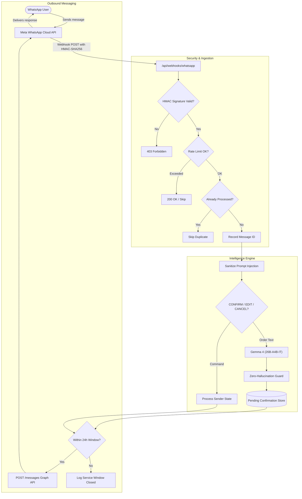

# Convoza

<div align="center">
  
  <h3>From chat to clarity.</h3>
  <p>Turn chaotic WhatsApp conversations into structured group orders, exact paisa-perfect bills, and automated intelligence with <strong>Gemma 4</strong>.</p>

  [](https://github.com/SarthakPatil18/convoza/actions)
  [](https://opensource.org/licenses/MIT)
  [](https://nextjs.org/)
  [-blue)](https://ai.google.dev/)
  [](https://developers.facebook.com/docs/whatsapp/cloud-api)
</div>

---

## Table of Contents
- [Overview](#overview)
- [Key Features](#key-features)
- [Architecture & Data Flow](#architecture--data-flow)
- [AI Where It Matters, Code Where It Counts](#ai-where-it-matters-code-where-it-counts)
- [Technology Stack](#technology-stack)
- [Meta WhatsApp Cloud API Integration](#meta-whatsapp-cloud-api-integration)
- [Environment Variables](#environment-variables)
- [Quick Start](#quick-start)
- [Deployment on Vercel](#deployment-on-vercel)
- [Testing](#testing)
- [Project Structure](#project-structure)
- [Security & Privacy](#security--privacy)
- [License](#license)

---

## Overview

In hostels, college societies, housing complexes, and local kirana shops, one person inevitably has to collect everyone's requests from a messy WhatsApp chat filled with Hinglish slang, ambiguous quantities, last-minute cancellations, and scattered payment updates.

**Convoza** automates the entire process:
1. Ingests messages directly via the **official Meta WhatsApp Cloud API** or by pasting raw chat exports.
2. Extracts items, quantities, cancellations, and commitments using **Gemma 4 (`gemma-4-26b-a4b-it`)**.
3. Enforces a **zero-hallucination guard** requiring verbatim quoted source words for every single candidate.
4. Executes deterministic business rules and calculates financial totals in **integer paise** with Indian word formatting (*Lakh*, *Crore*).
5. Provides an interactive Web UI for review, receipt printing, and UPI deep-linking.

---

## Key Features

- **Direct WhatsApp Bot**: Users send items to Convoza's official WhatsApp Business number. Convoza extracts requests, isolates candidates per sender, and prompts for `CONFIRM`, `EDIT`, or `CANCEL`.
- **Hinglish & Hindi Understanding**: Fluidly translates colloquial Indian phrases (`"2 copy aur ek sharpener bhej dena"` &rarr; `2 Notebook`, `1 Sharpener`; `"nahi chahiye ab"` &rarr; cancellation).
- **Zero-Hallucination Guard**: Every item extracted by Gemma 4 must contain an exact verbatim substring in the original message. If the evidence cannot be verified, it is instantly discarded.
- **Paisa-Perfect Financial Math**: Floating-point math is strictly forbidden. All bill calculations, splits, and shared charges are calculated in integer paise.
- **Three Persona Roles**:
  - **Consumer**: Personal consolidated bill addressed to you.
  - **Community**: Group order split per member to the exact paisa.
  - **Merchant**: Individual shop invoice per customer with shared delivery/packing allocations.
- **Chat Analyzer & Extractor**: Paste any multi-person chat and generate:
  - Task Checklists with owners and deadlines
  - Google Calendar schedules with `.ics` export
  - Shared expense digests (paid vs. pending)
  - Delivery trackers (delivered, late, missing)
  - Interactive project milestones & timelines
- **Crowdmind Feed**: Community marketplace for buyers, groups, and merchants. Gemma automatically tags posts and detects advance-payment or OTP/UPI-PIN scams before publication.
- **Theme & Language Engine**:
  - Three distinct design presets: **Classic** (kraft-paper editorial), **Vintage** (aged parchment), and **Mono** (high-contrast print).
  - Native multi-language support in **English**, **हिन्दी**, **ಕನ್ನಡ**, **ગુજરાતી**, and **বাংলা**.

---

## Architecture & Data Flow



---

## AI Where It Matters, Code Where It Counts

| Gemma 4 (`gemma-4-26b-a4b-it`) | Deterministic TypeScript |
|---|---|
| Reads unformatted messages in English, Hindi, and Hinglish | Splits raw chat exports by sender, timestamp, and device format |
| Classifies intent (`order`, `cancel`, `chatter`) | Validates all model responses against strict Zod schemas |
| Extracts product names, variants, and quantities | Zero-hallucination validation: drops items without verbatim quote matches |
| Identifies ambiguity and missing details (`quantity: null`) | Groups items by normalized singular key across members |
| Tags community posts and detects scam/phishing patterns | Integer paise math for line totals, tax, splits, and currency formatting |
| Extracts tasks, dates, and event descriptions | UPI deep-link and QR code generation |

> [!IMPORTANT]
> Gemma 4 is never permitted to execute database writes, financial transactions, or WhatsApp API calls directly. All actions pass through TypeScript business validation.

---

## Technology Stack

- **Framework**: [Next.js 16](https://nextjs.org/) (App Router, Node.js server runtime)
- **UI & Components**: [React 19](https://react.dev/), Tailwind CSS v4, Inline SVG icons
- **AI Inference**: [Google GenAI SDK](https://www.npmjs.com/package/@google/genai) (`@google/genai`)
- **Primary AI Model**: `gemma-4-26b-a4b-it` (26B total, 4B active MoE parameters)
- **Validation**: [Zod](https://zod.dev/) v3.25
- **Messaging**: Meta WhatsApp Cloud API v21.0
- **Database**: [Supabase](https://supabase.com/) (PostgreSQL with Row Level Security)
- **Testing**: [Vitest](https://vitest.dev/) (250+ unit and route integration tests)
- **Payments**: Native UPI URI protocol (`upi://pay`) & QR generation

---

## Meta WhatsApp Cloud API Integration

Convoza provides full official Meta WhatsApp Business integration out of the box.

### Webhook Endpoints
- **`GET /api/webhooks/whatsapp`**: Responds to Meta's webhook verification challenge (`hub.mode`, `hub.verify_token`, `hub.challenge`).
- **`POST /api/webhooks/whatsapp`**: Ingests incoming WhatsApp messages and delivery statuses.
  - Verifies the `X-Hub-Signature-256` header using HMAC-SHA256 and `WHATSAPP_APP_SECRET`.
  - Compares tokens securely with constant-time equality checks (`timingSafeEqual`) to prevent timing attacks.
  - Automatically deduplicates inbound messages using `messageId` idempotency tracking.
  - Enforces the Meta **24-hour customer service window** before attempting outbound replies.

### Conversational State Machine
Users can control their pending order candidates via single-word WhatsApp messages:
- `CONFIRM`: Commits and finalizes the user's pending order candidate.
- `EDIT`: Prompts the user to re-send revised items to replace the pending state.
- `CANCEL`: Discards any active pending candidates for that user.
- `HELP`: Returns guidance on available commands and ordering examples.

> [!NOTE]
> Confirmation state is strictly isolated per sender phone number. A user cannot confirm, view, or modify another user's pending items.

---

## Environment Variables

Copy the provided reference file to configure your local environment:

```bash
cp .env.example .env.local
```

### Reference Table

| Variable | Required | Description | Example / Default |
|---|---|---|---|
| `LLM_PROVIDER` | **Yes** | AI provider (`gemini` for production, `ollama` for local) | `gemini` |
| `GEMINI_API_KEY` | **Yes** | Google AI Studio API key | `AIzaSy...` |
| `GEMMA_MODEL` | **Yes** | Target Gemma 4 model identifier | `gemma-4-26b-a4b-it` |
| `WHATSAPP_ACCESS_TOKEN` | Optional* | Meta System User token with messaging permissions | `EAA...` |
| `WHATSAPP_PHONE_NUMBER_ID` | Optional* | Phone Number ID from Meta WhatsApp API Setup | `1029384756` |
| `WHATSAPP_WABA_ID` | Optional* | WhatsApp Business Account ID | `9876543210` |
| `WHATSAPP_APP_SECRET` | Optional* | Meta App Secret (for HMAC-SHA256 webhook verification) | `f4c...` |
| `WHATSAPP_VERIFY_TOKEN` | Optional* | Custom secret string matched in Meta Webhook config | `my_verify_secret` |
| `WHATSAPP_GRAPH_API_VERSION` | Optional* | Graph API version | `v21.0` |
| `SUPABASE_URL` | Optional | Supabase Project URL for durable idempotency & posts | `https://xyz.supabase.co` |
| `SUPABASE_SECRET_KEY` | Optional | Supabase Service Role secret key | `eyJ...` |

*\* Required only when activating the WhatsApp Cloud API integration.*

---

## Quick Start

### Prerequisites
- Node.js `20.x` or higher
- A free Gemini API key from [Google AI Studio](https://aistudio.google.com/apikey)

### Installation

```bash
# 1. Clone the repository
git clone https://github.com/SarthakPatil18/convoza.git
cd convoza

# 2. Install dependencies
npm install

# 3. Configure environment
cp .env.example .env.local
# Edit .env.local and insert your GEMINI_API_KEY

# 4. Start local development server
npm run dev
```

Visit [http://localhost:3000](http://localhost:3000) to access the application.

---

## Deployment on Vercel

1. Push your repository to GitHub.
2. In the [Vercel Dashboard](https://vercel.com/dashboard), import your repository.
3. In **Project Settings → General**:
   - **Framework Preset**: Ensure it is set to **Next.js**.
   - **Output Directory**: Leave toggle **Disabled / OFF** (do not override).
4. In **Project Settings → Environment Variables**, add:
   ```env
   LLM_PROVIDER=gemini
   GEMMA_MODEL=gemma-4-26b-a4b-it
   GEMINI_API_KEY=your_gemini_api_key_here
   ```
   *(Add WhatsApp and Supabase variables as needed).*
5. Click **Deploy**.

---

## Testing

Convoza maintains comprehensive test coverage across parsers, financial arithmetic, guards, and webhook security.

```bash
# Run all unit and route integration tests (250+ tests)
npm test

# Run strict TypeScript type verification
npm run typecheck

# Run production build compilation check
npm run build

# Run prompt regression harness against a live model
npm run test:prompts
```

### Live Opt-In Integration Tests
Real network requests to Meta and Google are disabled by default. You can trigger them explicitly:

```bash
# Test live Gemma 4 extraction
TEST_LIVE_GEMMA=1 npm test lib/whatsapp/integration.live.test.ts

# Test live WhatsApp outbound messaging
TEST_LIVE_WHATSAPP=1 TEST_WHATSAPP_RECIPIENT="919876543210" npm test lib/whatsapp/integration.live.test.ts
```

---

## Project Structure

```text
├── app/
│   ├── api/
│   │   ├── analyze/          # Full chat multi-agent analysis endpoint
│   │   ├── crowdmind/posts/  # Moderated community feed API
│   │   ├── extract/          # Specific structure extraction (calendar, tasks, etc.)
│   │   ├── health/           # Health & provider readiness probe
│   │   ├── parse/            # Per-message extraction endpoint
│   │   └── webhooks/whatsapp # Meta WhatsApp GET & POST webhook route handler
│   ├── bill/[id]/            # Sharable paisa-perfect bill & UPI receipt page
│   ├── build/                # Convoza interactive order builder
│   ├── crowdmind/            # Community marketplace page
│   └── layout.tsx            # Theme provider, layout shell & head metadata
├── components/
│   ├── Art.tsx               # Lightweight zero-dependency SVG illustrations
│   ├── Builder.tsx           # Order assembly, flag resolution & item grouping
│   ├── Header.tsx            # Sticky navigation, language & theme switcher
│   ├── Landing.tsx           # Multi-language hero & interactive product showcase
│   └── Prefs.tsx             # Theme and language persistent state context
├── docs/
│   ├── SUPABASE.sql          # SQL schema for Crowdmind posts
│   └── WHATSAPP_SUPABASE.sql # SQL migration for WhatsApp idempotency & confirmations
├── lib/
│   ├── analyze/              # Higher-level chat summarization & tools extraction
│   ├── crowdmind/            # Post moderation, scam filter & store adapters
│   ├── whatsapp/             # Webhook parsing, HMAC verification, send & state machine
│   ├── aggregate.ts          # Deterministic grouping & cancel subtraction logic
│   ├── bill.ts               # Bill generation, item splits & UPI URI builder
│   ├── guard.ts              # Zero-hallucination quote-matching engine
│   ├── i18n.ts               # Multi-language dictionary (en, hi, kn, gu, bn)
│   ├── llm.ts                # Exclusive gateway to Gemma 4 via Google GenAI SDK
│   ├── money.ts              # Integer paisa math & split algorithms
│   └── readMessage.ts        # Message ingestion pipeline (Trivial guard -> Gemma -> Guard)
├── public/                   # Static assets & icons
└── vercel.json               # Vercel Next.js framework configuration
```

---

## Security & Privacy

- **Zero API Key Leakage**: API keys and tokens are restricted strictly to Node.js server runtimes and are never bundled into client-side code or error responses.
- **Strict Webhook Authentication**: Inbound WhatsApp payloads are validated with HMAC-SHA256 signatures before reading body contents.
- **Prompt Injection Defense**: WhatsApp text messages undergo boundary filtering to strip fake system roles before reaching the LLM context.
- **Private Data Protection**: Raw phone numbers are masked in server logs, and message contents are not stored unless explicitly confirmed by the sender.

---

## License

Convoza is open-source software licensed under the [MIT License](LICENSE).
